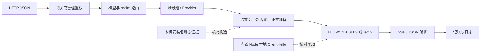

# 项目复审与 WorkBuddy 请求一致性核对

## 结论

**不是完整 WorkBuddy 客户端复刻。** 当前实现是兼容网关，加上桌面请求 profile。已用本机 WorkBuddy **5.9.3 / CLI 2.165.0 / Node v22.21.1** 的安装工件和内嵌运行时核对；TLS ClientHello 的 JA3、标准 JA4 与 helper 一致。初轮发现的登录、隐私判定和工具请求差异已继续补齐，最新实现与验证见 [UPSTREAM_ALIGNMENT.md](UPSTREAM_ALIGNMENT.md)。完整客户端动态配置与生命周期仍单独列为边界。

本页的测试统计和修改清单保留初轮复审时间点；后续对齐不改写原始证据记录。

本轮修复了管理鉴权、异常 JSON、并发记账、保活竞争、探测忙循环、余额聚合/分页、SSE 完成判定、工具索引上界及 HTTP 传输问题。没有修改实际账号、上游凭据、数据库内容或本机 `.env`；没有发送真实上游聊天请求。

## 直接验证

```powershell
npm test
npm run lint
node node_modules/typescript/bin/tsc --noEmit --incremental false
npm run test:official-egress
node scripts/audit-workbuddy-runtime.mjs 'D:\workBuddyAI\WorkBuddy.exe' .runtime/workbuddy-runtime-evidence.json
```

最后一条只在先验证 Electron `RunAsNode` fuse 已启用后执行一段独立 Node TLS 代码，连接 `127.0.0.1`。它不加载应用主程序、登录态或用户配置。**这验证运行时默认 ClientHello，不等于采集了一次真实应用 API 请求。**

隔离构建使用 `WB2A_NEXT_DIST_DIR=.runtime/review-build-next`，并设置 `WB2A_DISABLE_SCHEDULER=1`、假数据库通道，保留既有 `.next` 和本机 3000 服务。正式 `npm run build` 默认目录仍是 `.next`。既有服务需在其操作者安排的重启后完整加载升级后的 Next.js。

## 机制与核验顺序



核验区分三个层次：安装代码的静态实现、离线服务器实际收到的字节、真实应用完整请求。只有前两层获得了本轮证据；第三层没有伪装成“已通过”。

## WorkBuddy 一致性矩阵

| 项目 | 实际证据与结果 | 结论 |
|---|---|---|
| 产品与 CLI 版本 | 包内 `package.json` 为 5.9.3 / 2.165.0；项目 CN 默认相同 | 本机 CN 版本匹配 |
| OpenAI JS SDK | 安装 chunk 中版本 6.25.0；项目请求头相同 | 默认 SDK 版本匹配 |
| OS / 架构 / Node | 实采运行时 win32 / x64 / v22.21.1；项目固定 Windows / x64 / v22.21.1 | 此本机 profile 匹配，非所有平台动态适配 |
| TLS | 实采 JA3 MD5 `71dc8c533dd919ae9f4963224a4ba8fd`；标准 JA4 `t13d181000_5d04281c6031_78e6aca7449b` | helper 与本机默认运行时匹配 |
| JA4 测试算法 | 旧算法交换了计数顺序、用十六进制计数、排序 signature algorithms | 已按标准修正，不再把自定义散列叫标准 JA4 |
| chat gzip | 默认产品 `RequestBodyGzip=true`，支持的默认链路对每个非空 POST 正文压缩，无 1024B 阈值 | 已修复；自定义 URL、功能开关等动态排除条件没有完整建模 |
| 聊天消息 ID | 本机代码使用去横线 UUIDv7，42-bit 单调计数 | 已修复版本/variant 位、计数与小幅时钟回拨处理 |
| trace | 16 位 B3 trace 曾直接进入要求 32 位的 W3C 字段；零 trace 曾被保留 | 已修复 padding、大小写和非法值回落 |
| 头名称/顺序/分块/压缩 | 本地 HTTP/TLS 服务器实收测试 | 固定 profile 契约通过，不是当前应用所有请求的抓包证明 |
| 登录 | 后续已改为 WorkBuddy platform/RPC UA/CN 主域与 Bearer `/v2/plugin/account` | 已按默认构造对齐，真实账号授权尚未执行；见 AL01–AL24 |
| `X-Private-Data` | 后续已接入显式偏好、产品默认和企业 edition 判定 | 公式对齐，支持每 UID 覆盖；未读取实际桌面用户设置，见 AP01–AP03 |
| search / webfetch | 后续改为独立 CLI 头族、原生 fetch 与完整 body | 默认字段已对齐；数量/超时/长度兼容扩展仍明确保留，见 AT1–AT10 |
| refresh / report ID | 共用生成器的不同调用路径没有逐条动态采集 | 待动态对拍，不泛化 chat 的 UUIDv7 证据 |
| 遥测与设备身份 | 项目按 UID 派生设备字段，固定硬件与部分事件内容；并非真实安装状态 | 不是完整客户端身份/行为生命周期 |
| Global 5.9.4 | 项目有静态 profile，本机此次发现的是 CN 5.9.3 | 未取得同版 Global 应用请求基线 |
| Provider 通道 | 按设计直接转发第三方 OpenAI 服务 | 不属于 WorkBuddy 仿真范围 |

TLS 的相同不证明服务端将其认定为完整桌面客户端，也不证明所有请求字段、配置更新、重试和遥测序列相同。

### 安装工件身份

- ASAR：`D:\workBuddyAI\resources\app.asar`，SHA-256 `dcabcd90f07a627a06f1fd55bc872a1c25a79aab43c3012930b6287840ab3d20`。
- 运行时：`D:\workBuddyAI\WorkBuddy.exe`，SHA-256 `bbf504003825e0e22dd8c401b396d79db78ec603558088565d1b2e81561704a0`。
- CLI bundle：`cli/dist/codebuddy-lite-wb.mjs`，SHA-256 `c57a02ee3f2ef813004262cd003774a6e71bd2a6f5005481359301b407977ea5`。
- 产品 gzip 默认值：`cli/product.json` 字节偏移 369049；gzip 处理器：bundle 字节偏移 3885531；SDK：chunk 1885 字节偏移 114546；UUIDv7：bundle 9857900 附近。原始短摘录、每个工件 hash 和全部 WB 编号在 [静态证据](docs/review-2026-11-20/workbuddy-profile.json)。

REA 记录发现部分 unpacked 文件与 ASAR 声明 hash 不一致。原因没有在本轮认定；本机副本仍可作为“本机观测”证据，但不等同于厂商原封发布件认证。范围与限制保存在 [工件摘要](docs/review-2026-11-20/artifact-summary.json)。

## 已修复项与证据

| 编号 | 修改位置 | 原行为 → 目标行为 | 回归证据 |
|---|---|---|---|
| E01 | `src/lib/panel-auth.ts:21`、`src/app/panel/page.tsx:51`、`src/app/panel/lib.ts:32` | 管理 API 无条件放行、前端不发 Bearer → 仅主密钥、缺配置 503、401 回登录、响应 no-store | auth-boundary、panel-auth-client；浏览器 5 项 |
| E02 | `src/lib/auth-guard.ts:104` | DB 故障可退化为免鉴权 → 失败关闭；主密钥免查子密钥表，冷缓存 single-flight | auth-boundary |
| E03 | `scripts/audit-workbuddy-runtime.mjs:1` | 无真实运行时基线 → fuse 检查后采集本机 Node 模式 ClientHello | [运行时实采](docs/review-2026-11-20/workbuddy-runtime.json) |
| E04 | `scripts/official-client-hello.test.mts:10`、`src/lib/upstream/client.ts:77`、`src/lib/upstream/official-egress.ts:219` | 错误 JA4 算法、非 v7 消息 ID、错误 gzip 阈值 → 标准 JA4、单调 UUIDv7、默认非空 chat POST 压缩 | official-client-hello、official-egress、client-profile；WB02–WB24 |
| E05 | `src/lib/request-validation.ts:1`、四个 v1 POST 入口、账号导入/建 key | null/数组/错误字段造成 500 → 运行期结构校验和 400/逐项跳过 | request-validation、import-validation |
| E06 | `src/lib/pool.ts:54`、`:857`、`:981` | 同账号并发扣费丢更新 → 按 UID 串行，与权威余额刷新共用边界，队列结束清理 | pool-settlement-concurrency：100−10−20 从 80 修为 70 |
| E07 | `src/lib/cron.ts:313` | 同进程请求可同时取得非原子 DAL 租约 → 首个 await 前设置本地互斥，finally 释放 | keepalive-concurrency |
| E08 | `src/lib/scheduler.ts:270` | 空池/无新健康记录时探测忙循环 → 本地执行时间也约束下次周期 | scheduler-health-cadence |
| E09 | `src/lib/provider.ts:240` | 响应头后 JSON/错误正文可永久挂起 → 正文 idle timeout 返回 504，取消保持 499，0 表示关闭监控 | provider-body-timeout |
| E10 | `src/lib/upstream/sse.ts:457` | 提前 EOF/idle 取消被补成成功 → 保留 partial，记录 incomplete 错误；有 finish_reason 仍兼容缺 DONE | sse-safety、既有 sse-repair |
| E11 | `src/lib/upstream/sse.ts:41`、`src/lib/provider-observation.ts:33` | 极大工具索引可扩张数组 → 显式整数 0–1023 上界和可观测错误 | sse-safety |
| E12 | `src/lib/balance.ts:132`、`:197` | 首值 0 被当缺失，跨折叠段重复计涨跌 → 区分缺失，按下一段首值衔接 | balance-aggregation |
| E13 | `src/app/api/panel/balance_history/route.ts:38` | CloudBase 历史静默截断 1000 条 → 使用现有 DAL 完整分页和日期解码 | balance-history-pagination：2501 条，offset 0/1000/2000 |
| E14 | `src/lib/usage-query.ts:119` | `a+bc`、`ab+c` 分组碰撞 → 内部 JSON tuple，输出与 SQL 分隔符一致 | usage-dal-parity |
| E15 | `src/lib/upstream/official-egress.ts:197` | raw 头值/重复头/错误长度不校验 → 拒绝 CRLF、非法名称、歧义请求 framing；响应也严格检查 framing 与大小 | official-egress-security |
| E16 | `src/lib/upstream/official-egress.ts:613`、`:655`、`:703` | 大 chunk 整块缓存、解压可能挂起、旧 body 取消误伤复用连接 → 增量 chunk、字节背压、取消/异常绑定所有权、移除解压后失效的长度头 | official-egress-security、四类解压与取消检查 |
| E17 | `src/lib/upstream/official-egress.ts:143`、`:595` | 空闲池无上界/已关连接残留，信任参数混用 → 每 origin 8、总计 64；关闭清理，proxy 凭据/目标/CA 分池 | 线缆回归与源码回读 |
| E18 | `eslint.config.mjs:1`、`scripts/test-offline.mjs:1` | lint 扫技能缓存、维护脚本规则失配；测试依赖固定本机路径与外网 → 源码保持严格规则，测试可移植且隔离网络/DB | npm test、npm run lint |
| E19 | `package.json:1`、`package-lock.json` | Next/ESLint 16.4.2 → 16.4.6；更新兼容范围内传递依赖 | build、lint、测试及 npm audit |
| E20 | `.dockerignore:1`、`README.md:38`、`.env.example` | 构建可带技能/备份/原始快照，文档含明文密码与旧语义 → 排除本机工件，移除文档密码，修正日志/鉴权说明 | 文件差异与回读；实际 `.env` 未改 |
| E21 | `next.config.ts:19` | 通配 Tailwind loader 破坏 CSS module 标识 → 只处理 globals.css，恢复原生 CSS module 管线 | next-config、实际完整构建 |

同会话内另外出现的日志/缓存和 Agent 工作台改动予以保留，不计为本轮主修复成果。对工作台仅做了编译阻塞的最小 `NODE_ENV` 类型修正、事件 union 收窄、unused import 清理和运行期路径 tracing 标记；这些文件另存并发修改前像，不回退整套外部功能。

## 验证记录与覆盖边界

- **离线全量**：148 tests，147 pass，0 fail，1 skip。跳过项是真数据库余额集成测试；没有把跳过写成通过。记录：`.runtime/review-final-tests.log`。
- **浏览器/API**：API 3 项（401/401/200）、浏览器 5 项通过；pageErrors=[]；假 DB 7 次 GET、0 写入。见 [结果](docs/review-2026-11-20/panel-smoke.json)、[登录截图](docs/review-2026-11-20/login.png)、[空账号截图](docs/review-2026-11-20/accounts-empty.png)。IME 为 DOM 合成事件，不是物理输入法终验。
- **lint / TypeScript / build**：以 `.runtime/review-final-lint.log`、`review-final-typecheck.log`、`review-final-build.log` 及本目录 `verification.json` 的最终状态为准。生产构建使用独立目录；并发新增模块曾导致暂态编译错误，没有删除或排除失败源码来掩盖它。
- **Go**：`go test -vet=all ./...` 退出 0，但该 Go 包没有独立 test 文件；实际 TLS 握手与复用由 Node 线缆测试覆盖。
- **范围**：起始备份含 346 文件，其中源码 201 文件、API route 77 个；全量静态/构建门禁覆盖最后检查时的工作区。人工重点沿鉴权、账号池、上游发送、流解析、记账、调度和 DAL 链路复核，不是对所有代码无缺陷的形式化证明。
- **新增并发工作台/Mirasim 功能**：仅纳入编译和现有离线测试；没有运行真实 Agent、创建云资源或验收其完整功能。

## 未解决项 / backlog

1. **完整客户端动态对拍**：后续已补齐登录默认参数/UA、隐私公式和工具默认请求。仍未执行真实账号授权，未取得 host 动态登录附加头、实际 AB/用户偏好、report/refresh 全部最终头、配置更新、设备身份、会话/遥测序列及 Global 同版本完整流量，不写“100% 伪装成功”。
2. **依赖通告**：全量和 `--omit=dev` 审计均还报告 Prisma 配置链 **4 个 high package entries**，对应 deepmerge-ts、effect 两个源通告及其上游依赖传播。没有用忽略项抹掉结果，也没有强行跨大版本替换 Prisma。详见 [审计 JSON](docs/review-2026-11-20/npm-audit.json)。
3. **多实例原子性**：本轮保活/余额互斥修复遵守已有单容器约定；多实例需要数据库原子操作/RPC。余额折叠的多步写入崩溃恢复尚未完成事务化验证。
4. **现网与视觉覆盖**：未执行真实 DB 集成、云迁移、真实上游计费请求、物理 IME 或全部页面视觉回归；本机原服务和账号配置保留。

## 逐文件改动与回退

- 原始备份：`.codex-backup/review-20261120-095054/`。
- 逐文件原始/目标 SHA-256、文件类别及前像位置：`docs/review-2026-11-20/changes.json`。
- 本轮完整源码差异保存在本机备份目录的 `task-changes.patch`；其中包含原始文档前像，未把它发布到共享证据目录。
- 回退脚本只处理登记的本轮文件，不重置 Git、不覆盖其它并发新文件。默认只检查；执行前核对目标 hash，后续已改的文件会报冲突。
- 同一文件与其它任务交叉编辑时，按差异手工合并更精确；脚本恢复的是该文件的登记前像，而不是语义级撤销某一行。

```powershell
# 仅检查前像、路径与目标 hash
& '.\.codex-backup\review-20261120-095054\Restore-Review.ps1'
# 实际还原登记文件（新建的本轮文件移入备份，不递归删除）
& '.\.codex-backup\review-20261120-095054\Restore-Review.ps1' -Apply
# 若已回退依赖清单，再按还原后的 lockfile 重装
npm ci
```

## 标准与公告来源

- JA4 算法按 cipher/extension 十进制计数、signature algorithms 原始顺序校正：[FoxIO JA4 规范](https://github.com/FoxIO-LLC/ja4/blob/main/technical_details/JA4.md)。
- UUIDv7 版本位与布局：[RFC 9562 §5.7](https://www.rfc-editor.org/rfc/rfc9562.html#section-5.7)；W3C trace-id 格式：[Trace Context](https://www.w3.org/TR/trace-context/#trace-id)。
- Next.js 自托管转发响应的 framing 公告直接关联此类代理场景，升级到 16.4.6：[Vercel GHSA-pc58-hwjq-p385](https://github.com/vercel/next.js/security/advisories/GHSA-pc58-hwjq-p385)。
- 剩余依赖通告：[deepmerge-ts](https://github.com/advisories/GHSA-ggr8-5vv4-36mx)、[effect](https://github.com/advisories/GHSA-7589-6fvf-x4pw)。
